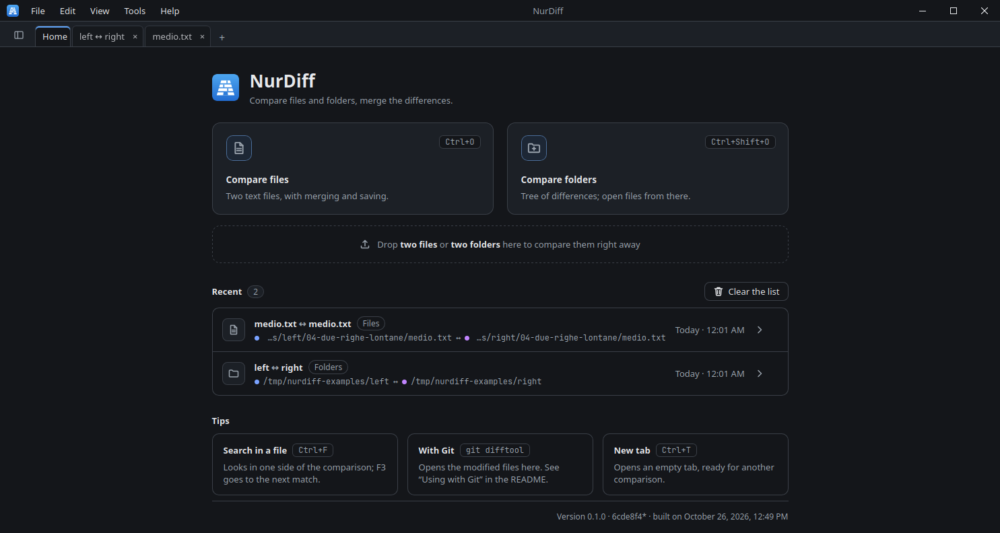
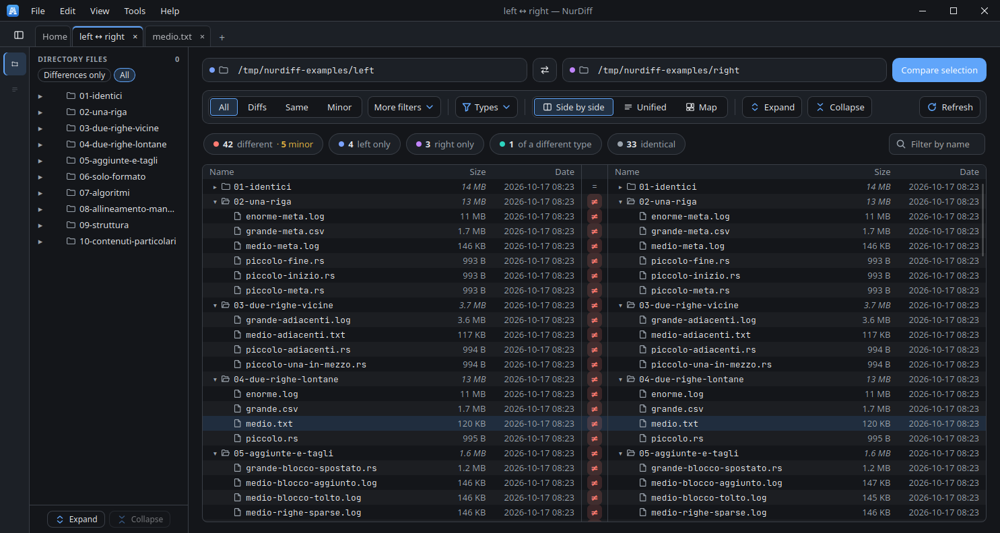
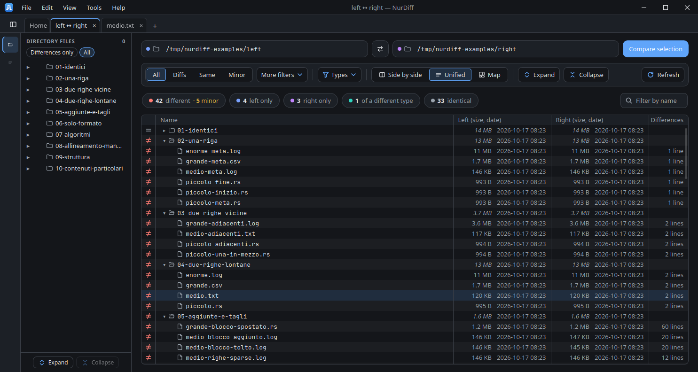
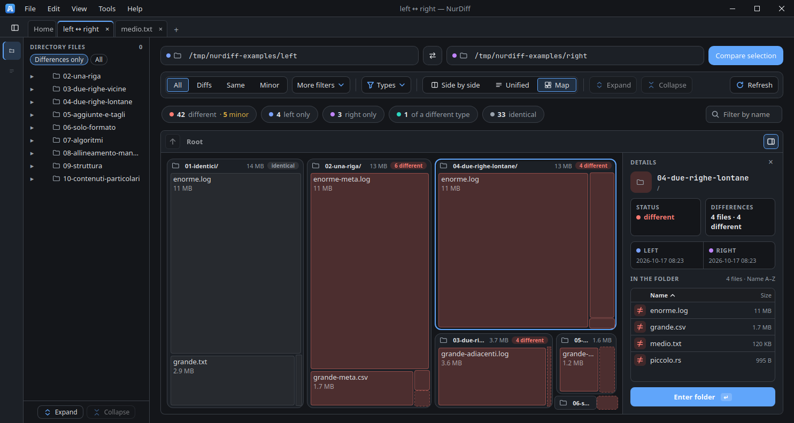
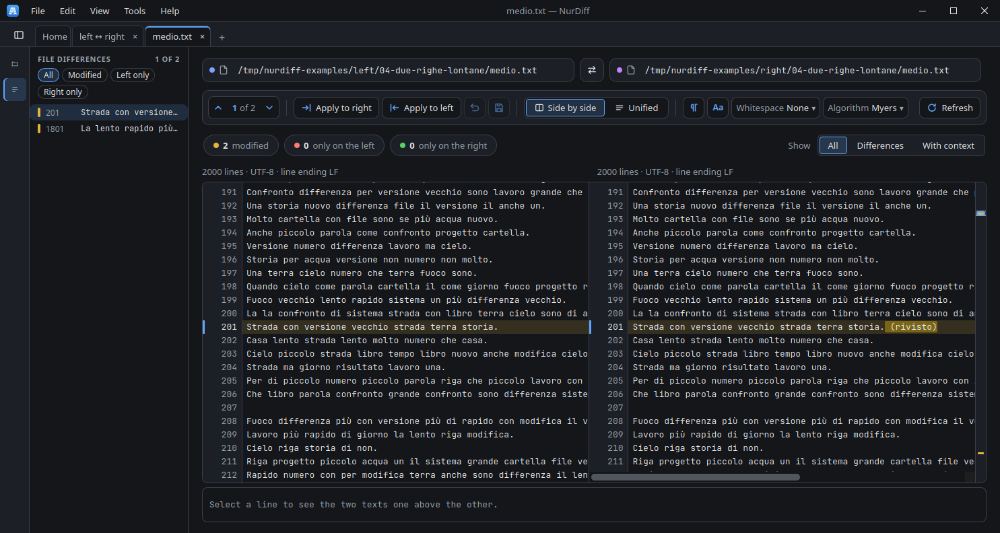
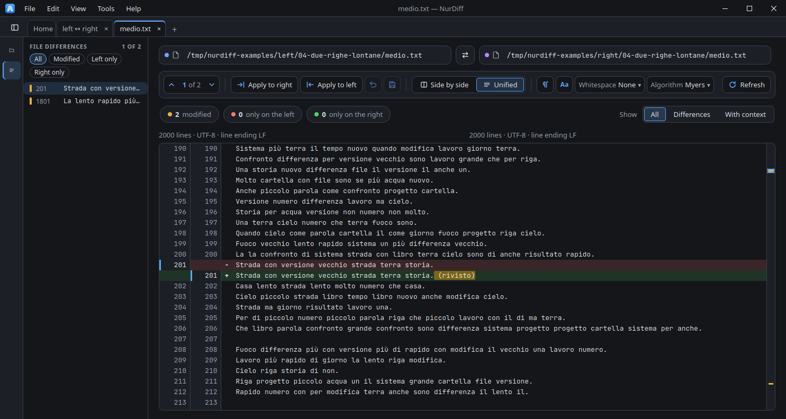

# NurDiff

[](https://github.com/anedda/nurdiff/actions/workflows/ci.yml)

Compare **files and folders** on Linux, Windows and macOS: side by side, unified, or (folders) as a map. It has a command-line tool and works as a `git difftool` and `git mergetool`.

Built with [Tauri 2](https://tauri.app), Rust, React and TypeScript.

> **About this project.** NurDiff is an experiment in building software with an AI coding assistant.

> **Status: early development.** It is developed and used on Linux. Windows and macOS are built by the CI, but have had little manual testing.

## Features

- **Files**: differences inside lines, three algorithms (Myers, Patience, Histogram), ignore case and whitespace, minor differences (line endings, encoding, trailing spaces) told apart from real ones, search (Ctrl+F), merge blocks from one side to the other and save.
- **Folders**: byte-by-byte comparison with a tree, filters (including by extension) and a preview before comparing. Symbolic links are not followed. NurDiff does not copy, mirror or delete files.
- **Archives**: `.zip`, `.jar`, `.apk`, `.epub`, `.tar`, `.tar.gz` and `.tgz` open like folders (read only), so two archives, or an archive and a folder, are compared file by file.
- **Reports**: unified diff and HTML for files, HTML and CSV for folders.
- Interface in English and Italian.

## Requirements

- **Linux**: WebKitGTK 4.1 (the `.deb` and `.rpm` ask for it; the AppImage needs FUSE).
- **Windows**: the WebView2 runtime, already on Windows 10 and 11.
- **macOS**: nothing, it uses the system webview.
- Git is needed only for the [Git](#git) integration.

## Install

Download the installer for your system from the [Releases page](https://github.com/anedda/nurdiff/releases): Linux (`.deb`, `.rpm`, AppImage), Windows (installer, or a portable `.zip` that needs only the WebView2 runtime, already present on Windows 10 and 11) and macOS. The command line is a separate archive.

- **.deb**: `sudo apt install ./NurDiff_*.deb`
- **.rpm**: `sudo dnf install ./NurDiff-*.rpm`
- **AppImage**: needs FUSE (`libfuse2`, or `libfuse2t64` on Ubuntu 24.04), then `chmod +x NurDiff*.AppImage && ./NurDiff*.AppImage`
- **Windows**: if SmartScreen warns about an unknown publisher, choose *More info*, then *Run anyway*.
- **macOS**: if the first start is blocked, open the app from its context menu, or run `xattr -dr com.apple.quarantine NurDiff.app`.

Each release has a `SHA256SUMS` file: `sha256sum --check --ignore-missing SHA256SUMS`. To build it yourself, see [Build from source](#build-from-source).

## Build from source

Nothing to install except [Podman](https://podman.io) (or Docker):

```bash
./scripts/build-linux.sh    # tests, then AppImage, .deb, .rpm and the command line in ./out
```

Without a container you need Rust, Node 20+ and the [Tauri prerequisites](https://tauri.app/start/prerequisites/) for your system:

```bash
npm install
npm run tauri build
```

## Command line

`nurdiff-cli` compares two files, two folders or two archives and prints the result like `diff`. Exit codes: `0` identical, `1` differences, `2` error.

```bash
nurdiff-cli a.txt b.txt
nurdiff-cli -i -w a.txt b.txt                 # ignore case and whitespace
nurdiff-cli --algorithm patience a.txt b.txt
nurdiff-cli --report html a.txt b.txt > report.html
nurdiff-cli --include rs,ts dir1 dir2         # only some extensions
nurdiff-cli v1.zip v2.zip
nurdiff-cli --help
```

## Git

```sh
nurdiff-cli --setup-git               # git difftool
nurdiff-cli --setup-git --mergetool   # and git mergetool
nurdiff-cli --remove-git              # undo
git difftool                          # or: git difftool --dir-diff --no-symlinks
```

The same is under **Tools → Options → Git**. Details and manual settings: [docs/git.md](docs/git.md).

## Limits

- A line longer than 4000 bytes, or with no word in common, is not highlighted inside.
- Without a byte-order mark, anything that is not valid UTF-8 is read as Latin-1.
- A missing final line break is not reported as a difference.
- Merging works on whole blocks of lines.
- Archives are extracted to a temporary folder (deleted on exit), up to 2 GB, 200,000 entries and a compression ratio of 200. Unsafe names, links and duplicate names are skipped; password-protected archives are refused; `.docx`, `.xlsx` and similar are not opened as archives.
- Very large files need memory (about eight times their size). Speed and measurements: [docs/performance.md](docs/performance.md).

## Settings

Saved as JSON in `~/.nurdiff/` (`%USERPROFILE%\.nurdiff` on Windows): `settings.json`, `recents.json`, `state.json`. Delete a file to restore the defaults; set `NURDIFF_CONFIG_DIR` to use another folder.

## Development

```bash
./scripts/dev.sh check              # fmt, ESLint, tsc, vitest, clippy, Rust tests (same as the CI)
./scripts/dev.sh ui [suite…]        # UI test in Chromium, with the calls to Rust simulated
./scripts/dev.sh gui [port]         # the full app on your X11 desktop (dev server on 1420, or the port given)
./scripts/dev.sh shell              # a shell in the container
```

Rust, Node, the webview libraries and Chromium all live in the container image. Without a container: `cargo test`, `npm install`, `npm test`, `npm run tauri dev`. More in [docs/development.md](docs/development.md).

### Layout

| Path | What it is |
| --- | --- |
| `crates/core` | the comparison engine (diff, merge, folders, reports; no dependency on the interface) |
| `crates/archive` | reads archives (zip, tar) into a temporary folder so they compare like folders |
| `crates/cli` | the `nurdiff-cli` command line |
| `src-tauri` | thin Tauri commands over the crates |
| `src` | the React interface |
| `tools` | the UI test and the fixtures it uses |

## Deployment

Releases are built by GitHub Actions (`.github/workflows/release.yml`):

1. Set the same version in `package.json`, `src-tauri/tauri.conf.json` and `Cargo.toml`.
2. Push a tag `vX.Y.Z` that matches it (the workflow stops if it does not).
3. The workflow builds the installers for Linux, Windows (with the portable `.zip`) and macOS (Apple silicon and Intel), and the command line for each system, and attaches them to a **draft** release together with `SHA256SUMS`.
4. Check the draft, then publish it on the Releases page.

Started by hand from the Actions tab, the workflow publishes nothing: the files stay as artifacts of the run. To build the Linux packages locally, see [docs/development.md](docs/development.md).

## Contributing

Issues and pull requests are welcome. Please run `./scripts/dev.sh check` before sending a change.

## Screenshots













## License

Copyright © 2026 Valentino Anedda.

GNU General Public License, version 3 or (at your option) any later version: see [LICENSE](LICENSE). The components NurDiff uses and their licenses are listed in [THIRD-PARTY-NOTICES.md](THIRD-PARTY-NOTICES.md).
